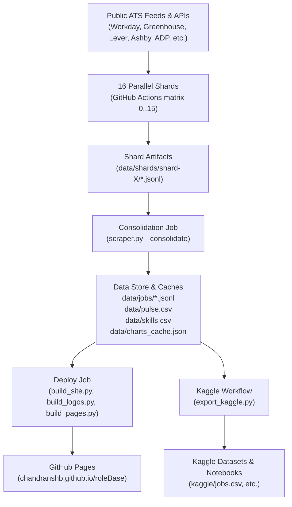

# RoleBase: Agent & Developer Operational Manual

Welcome to **RoleBase**. This document is the definitive operational handbook for both AI coding agents and human software engineers. It outlines the architectural design, directory structure, data schemas, invariant rules, and step-by-step developer playbooks.

---

## 1. System Architecture & Data Lifecycle

RoleBase is an automated, distributed job indexing platform that continuously aggregates open job vacancies across 50+ applicant tracking systems (ATS) and enterprise feeds, enriching postings with extracted metadata (seniority level, field category, required experience years, pay ranges, and technical skills) and publishing the results to GitHub Pages and Kaggle.



### Data Pipeline Stages:
1. **Sharded Crawling (`scrape.yml` matrix `0..15`)**:
   - The crawl space (~103,000 employer boards in `companies.json`) is deterministically partitioned across 16 parallel runner shards.
   - Each shard fetches its assigned boards with per-provider rate limiting and lane concurrency (`LANES`).
   - Only modified boards and health logs are saved and uploaded as shard artifacts.
2. **Consolidation (`scraper.py --consolidate`)**:
   - Downloads all 16 shard artifacts.
   - Prunes closed jobs older than 90 days into `data/archive.csv`.
   - Computes daily pulse metrics (`data/pulse.csv`), skill demand (`data/skills.csv`), and precomputes company hiring analytics into `data/charts_cache.json`.
   - Commits updated data to `main`.
3. **Site Generation & Deployment (`build_site.py`, `build_logos.py`, `build_pages.py`)**:
   - Multi-threaded streaming reads active jobs from `data/jobs/*.jsonl`.
   - Generates compact search indices `_site/jobs.json`, `_site/companies.json`, `_site/facets.json`.
   - Fetches and caches high-resolution SVG/PNG company icons (`logo-cache/`).
   - Generates static SEO pages for companies and roles.
   - Deploys static site to GitHub Pages.
4. **Kaggle Dataset Export (`export_kaggle.py`)**:
   - Batches all 103k boards in bounded 2,000-file chunks.
   - Generates 4 clean relational CSV datasets (`jobs.csv`, `jobs_by_company.csv`, `open_jobs_daily.csv`, `skill_demand_daily.csv`).
   - Validates schema against column metadata assertions.
   - Pushes new dataset version and starter notebook to Kaggle.

---

## 2. Directory Structure & File Manifest

```
roleBase/
├── .github/
│   └── workflows/
│       ├── ci.yml              # CI test & lint quality gate (PRs & pushes)
│       ├── scrape.yml          # 16-shard 6-hourly crawl & site deployment
│       └── kaggle.yml          # Daily Kaggle dataset export & publishing
├── rolebase/                   # Core modular Python engine
│   ├── __init__.py             # Public package exports & version
│   ├── config.py               # Constants, regexes, paths, and mappings
│   ├── client.py               # Resilient HTTP Session with exponential backoff
│   ├── normalize.py            # Classification, extraction, and heuristics
│   ├── ghost.py                # Heuristic ghost job risk scoring
│   ├── storage.py              # JSONL persistence, slimming, and merge
│   ├── consolidate.py          # Shard merging & analytics precomputation
│   └── crawlers/               # ATS & feed crawler registry
│       └── __init__.py         # Platform registry (ATS, FEEDS, LANES)
├── tests/                      # Pytest & standard unittest test suite
│   ├── test_normalize.py       # Classification, level, category, skills tests
│   ├── test_ghost.py           # Ghost job score tests
│   ├── test_storage.py         # Slimming, merging, and collapse tests
│   └── test_pipeline.py        # Pipeline verdicts, URL derivations, and stats
├── data/
│   ├── jobs/                   # Primary JSONL database (one file per board)
│   ├── pulse.csv               # Historical daily open/fresher job counts
│   ├── skills.csv              # Historical daily skill demand shares
│   ├── charts_cache.json       # Precomputed site facets & company stats
│   └── health.json             # Consecutive board scrape health logs
├── web/                        # Frontend search web app (HTML/CSS/JS)
├── scraper.py                  # Root CLI entry point & backward-compatible facade
├── build_site.py               # Site search index generator (_site/jobs.json)
├── build_logos.py              # Icon scraper & optimizer (logo-cache/)
├── build_pages.py              # Static SEO HTML page generator
├── export_kaggle.py            # Kaggle CSV dataset exporter
├── companies.json              # Registry of employers mapped to ATS boards
├── domains.json                # Company website domain overrides for logos
├── pyproject.toml              # PEP 517/621 project configuration
├── requirements.txt            # Runtime dependencies
└── requirements-dev.txt        # Development, linting, and testing dependencies
```

---

## 3. Core Data Schemas

### 1. Job Record (Internal & `data/jobs/*.jsonl`)
Stored as compact JSONL lines. Empty or derivable values are omitted to minimize disk and diff footprint:

```json
{
  "id": "greenhouse:stripe:12345",
  "company": "Stripe",
  "title": "Software Engineer, Infrastructure",
  "team": "Platform",
  "location": "Seattle, WA",
  "country": "United States",
  "remote": true,
  "level": "senior",
  "category": "engineering",
  "employment": "full_time",
  "years": 5,
  "skills": ["python", "aws", "kubernetes"],
  "pay": [180000, 240000, "USD"],
  "posted": "2026-11-01",
  "first_seen": "2026-11-01",
  "closed_at": null,
  "reposts": 0
}
```

### 2. Company Analytics (`data/charts_cache.json`)
Precomputed during consolidation to eliminate real-time calculation bottlenecks during site builds:
- `company_stats`: `[[company, open_roles, fresher_roles, fresher_share, junior_asking_3plus, years_stated_share], ...]`

---

## 4. Critical Engineering Invariants

When modifying or adding code to this repository, AI agents and engineers MUST follow these constraints:

1. **Memory Ceiling (< 7 GB)**:
   - GitHub Actions standard runners have a strict memory budget. Never load all 103,000 board files into a single in-memory dictionary.
   - Always stream files using chunked iterators or batched file processing (`ThreadPoolExecutor(max_workers=8)`).
2. **Silence Watchdog Prevention**:
   - GitHub Actions terminates jobs that produce no standard output for ~10 minutes.
   - Long-running loops (e.g. `export_kaggle.py`, `consolidate`, `build_site.py`) must log periodic progress and flush output:
     ```python
     print(f"Processed {done}/{total}...", flush=True)
     ```
3. **Sorting Type Safety**:
   - Never assume job fields like `first_seen`, `posted`, `company`, or `url` are strings. In some boards, missing or corrupted values may parse as `float("nan")` or `None`.
   - In Python 3, comparing `float` and `str` raises `TypeError: '<' not supported between instances of 'float' and 'str'`.
   - **Always wrap sorting keys in `str()`**:
     ```python
     key=lambda r: (str(r.get("first_seen") or ""), str(r.get("url") or ""))
     ```
4. **Preserve Root Facade**:
   - `scraper.py` at the root must maintain re-exports and CLI invocation behavior. Existing workflow YAMLs and external cron jobs depend on `python scraper.py --shard ...` and `from scraper import ...`.
5. **No Regressions on CI**:
   - All tests in `tests/` and `test_scraper.py` must pass before pushing (`python -m unittest discover tests -v && python test_scraper.py`).

---

## 5. Developer Playbooks

### A. Adding a New ATS Platform Crawler
1. **Define Crawler Function** in `scraper.py`:
   ```python
   def my_ats(s: str, name: str) -> List[Dict[str, Any]]:
       data = get(f"https://api.myats.com/v1/{s}/jobs")
       return [
           job("my_ats", f"my_ats:{s}", j["id"], name or j["company"], j["title"], j["url"],
               location=j.get("location"), desc=j.get("description"))
           for j in data.get("jobs", []) if j.get("id") and j.get("title")
       ]
   ```
2. **Register Platform**:
   - Add URL template to `URLS` in `rolebase/config.py` and `scraper.py`.
   - Add entry to `ATS` dict in `scraper.py`.
   - Add concurrency limit to `LANES` in `rolebase/config.py`.
3. **Add Tests**:
   - Add URL derivation check in `tests/test_pipeline.py`.
   - Verify with `python -m unittest discover tests`.

### B. Adding or Updating Tracked Skills
1. Open [`rolebase/config.py`](file:///w:/Code/Projects/roleBase/rolebase/config.py).
2. For single-word skills (e.g., `zig`, `solidity`), append to the `SKILLS` string.
3. For multi-word skills or aliases (e.g., `power bi` -> `power_bi`), add to the `ALIAS` dictionary.
4. Run `python -m unittest tests/test_normalize.py` to verify regex compilation and token extraction.

### C. Running Tests & Verifying Locally
```bash
# Run complete unit test suite
python -m unittest discover tests -v

# Run legacy integration tests
python test_scraper.py

# Verify code quality with ruff
ruff check rolebase tests
```
