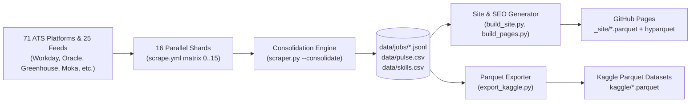

<p align="center">
  
</p>

<h1 align="center">Argus — Open Global Job Search Engine &amp; Apache Parquet Labor-Market Dataset</h1>

<p align="center">
  <strong>Direct first-party job indexing across 114,000+ employer career portals, 71 enterprise ATS platforms, and 25 public job feeds — refreshed every 6 hours, scored for ghost-job risk, and served end-to-end in Apache Parquet.</strong>
</p>

<p align="center">
  <a href="https://github.com/chandranshB/argus/actions/workflows/ci.yml"></a>
  <a href="https://github.com/chandranshB/argus/actions/workflows/scrape.yml"></a>
  <a href="https://github.com/chandranshB/argus/actions/workflows/kaggle.yml"></a>
  <a href="https://www.kaggle.com/datasets/chandranshbinjola/job-listings"></a>
  <a href="https://chandranshb.github.io/argus/"></a>
  <a href="LICENSE"></a>
</p>

---

## What Is Argus?

**Argus** is a free, open-source, distributed job search engine and longitudinal labor-market dataset that indexes **10M+ active job openings** directly from employer Applicant Tracking Systems (**71 ATS vendors**, **114,000+ career portals**, **98% of the Fortune 500**) plus **25 government and curated job feeds** every 6 hours.

Unlike traditional job aggregators that hide behind logins, paid APIs, or stale reposts, Argus queries first-party employer APIs directly, links straight to each company's official application page, scores every listing for **ghost-job risk** and **genuine entry-level ("0–2 years") accessibility**, and delivers both the **live GitHub Pages search web app** and the **daily Kaggle dataset** in columnar **Apache Parquet**.

* **Live Search Web App (Browser-Native Parquet)**: [chandranshb.github.io/argus](https://chandranshb.github.io/argus/)
* **Kaggle Relational Parquet Dataset**: [kaggle.com/datasets/chandranshbinjola/job-listings](https://www.kaggle.com/datasets/chandranshbinjola/job-listings)
* **Starter Exploratory Notebook**: [Job Listings Explorer](https://www.kaggle.com/code/chandranshbinjola/job-listings-explorer)
* **Developer & AI Agent Handbook**: [AGENTS.md](AGENTS.md) · [ARCHITECTURE.md](docs/ARCHITECTURE.md)

---

## Why Argus Stands Out (Comparison)

| Capability | **Argus** | Traditional Job Boards (LinkedIn, Indeed) | Commercial Job APIs | Single-Board Scrapers |
| :--- | :--- | :--- | :--- | :--- |
| **Source Verification** | **100% first-party ATS APIs** (71 platforms, 114k+ boards) | Mixed third-party & staffing reposts | Resold/scraped aggregates | 1–5 tech boards |
| **Ghost-Job Detection** | **Transparent heuristic `ghost_score`** (staleness, reposts, staffing, evergreen pools) | Paid "Promoted" boosts hide stale roles | None | None |
| **Entry-Level Truth Filter** | **Flags "junior" roles demanding 3+ yrs (`junior_asking_3plus`)** | Misleading seniority tags | Unverified titles | Keyword-only |
| **Delivery Format** | **End-to-end Apache Parquet** (web app + Kaggle + CLI) | Web UI / account wall | Rate-limited REST JSON | Ad-hoc CSV / JSON |
| **Refresh Cadence** | **Every 6 hours** via 16 parallel GitHub Actions shards | Opaque | Cached snapshots | Manual |
| **Industry Coverage** | **All sectors** (Engineering, Healthcare, Finance, Logistics, Retail, Legal, Skilled Trades) | General | Mostly Tech | Tech-only |
| **Cost & Access** | **$0 · No login · Open source (AGPL-3.0) + CC BY 4.0 aggregates** | Freemium / paywalled recruiters | \$\$–\$\$\$\$ / month | Custom maintenance |

---

## Key Features & Capabilities

* **71 Reverse-Engineered ATS Protocols**: Direct native APIs and protocol-level integrations across Workday (`appliedFacets` partitioning past 2,000), Oracle Recruiting Cloud (`postingDatesFacet` partitioning past 10k), Greenhouse, Lever, Ashby, SmartRecruiters, Phenom People, Eightfold (`pcsx` WAF-aware pacing), ADP Workforce Now, UKG Pro (`ultipro`), Dayforce, Paylocity (`window.pageData`), Paycom (Mantle `sessionJWT` + search API), iCIMS, Cornerstone OnDemand (CSOD), Oracle Taleo (Classic JSF `.ajax` + Fluid REST `searchjobs`), SAP SuccessFactors CSB, Radancy / TalentBrew (`/sitemap.xml` + HTML), Avature, Jobvite, Bullhorn, Teamtailor (`jobs.rss` + `/jobs/show_more` turbo-stream), Trakstar Hire, ApplicantPro/iSolved, Moka HR (AES-128-CBC decryption), Feishu/Lark Hire, Beisen i-Talent, ByteDance, Tencent, Baidu, JD.com, NetEase, and Unitree.
* **25 Public & Governmental Feeds**: Full coverage across Sweden's Arbetsförmedlingen *JobTech* (`43k+` ads via region/occupation partitioning), Germany's *Arbeitsagentur*, Singapore's *MyCareersFuture* (all 43 category slices), *AI Dev Jobs* (`9k+`), *NoFluffJobs* (`15k+`), *Get on Board*, *Y Combinator / Work at a Startup*, *Himalayas*, *Remotive*, *RemoteOK*, *Arbeitnow*, *We Work Remotely*, and niche engineering boards.
* **End-to-End Apache Parquet Pipeline**:
  * **Static Web App (`_site/*.parquet`)**: `build_site.py` generates Snappy-compressed `feed.parquet`, `jobs.parquet`, and `companies.parquet`, decoded directly in the browser via bundled pure-JS [`hyparquet`](web/vendor/hyparquet.mjs) with zero backend servers.
  * **Daily Kaggle Release (`kaggle/*.parquet`)**: `export_kaggle.py` outputs typed PyArrow Parquet tables (`jobs.parquet`, `jobs_by_company.parquet`, `open_jobs_daily.parquet`, `skill_demand_daily.parquet`) with ~85% smaller footprint than CSV.
* **Accurate Early-Career ("Fresher-Friendly") Index**: Isolates genuinely entry-level roles (`0–2` years required) and scores every employer on `fresher_share` and `junior_asking_3plus` ("experience inflation").
* **Ghost-Job Risk Scoring**: Deterministic audit assigning `ghost_score` and human-readable `ghost_reasons` for listings open `>180`/`>365` days, serial reposts, perpetual talent pools, or undisclosed staffing agencies.
* **80+ Normalized Skills & Multi-Currency Pay**: Extracts standardized skills (`python`, `aws`, `sql`, `cpr`, `ehr`, `osha`, `cdl`, `gaap`, `autocad`, etc.), seniority tier, domain category, and annualized salary with build-time ECB exchange rate conversion (`rates.json`).

---

## Market Snapshot

<table>
  <tr>
    <td></td>
    <td></td>
  </tr>
  <tr>
    <td></td>
    <td></td>
  </tr>
  <tr>
    <td></td>
    <td></td>
  </tr>
  <tr>
    <td colspan="2"></td>
  </tr>
</table>

---

## Querying Argus Parquet Datasets

### Python (`polars` / `duckdb` / `pyarrow`)

```python
import duckdb

# Query open entry-level remote engineering roles with transparent pay in sub-second SQL
df = duckdb.sql("""
    SELECT company, title, pay_min, pay_max, pay_currency, skills, url
    FROM 'kaggle/jobs.parquet'
    WHERE closed_at IS NULL
      AND fresher_friendly = TRUE
      AND remote = TRUE
      AND ghost_score = 0
      AND pay_min > 0
    ORDER BY first_seen DESC
    LIMIT 25
""").df()
```

```python
import pyarrow.parquet as pq

table = pq.read_table("kaggle/jobs_by_company.parquet")
```

### Apache Parquet Schemas

#### 1. Kaggle Relational Dataset (`kaggle/*.parquet`)

| File | Description | Key Columns |
| :--- | :--- | :--- |
| **`jobs.parquet`** | Open & recently closed (<90d) postings across 71 ATS + feeds | `source`, `company`, `title`, `url`, `openings`, `team`, `category`, `level`, `years_experience`, `employment`, `remote`, `location`, `country`, `skills`, `pay_min`, `pay_max`, `pay_currency`, `posted`, `first_seen`, `closed_at`, `ghost_score`, `ghost_reasons`, `fresher_friendly` |
| **`jobs_by_company.parquet`** | Employer early-career & transparency index (5+ open roles) | `company`, `open_roles`, `fresher_roles`, `fresher_share`, `junior_asking_3plus`, `years_stated_share` |
| **`open_jobs_daily.parquet`** | Daily global open vs. fresher-friendly time series | `date`, `open_jobs`, `fresher_friendly_jobs` |
| **`skill_demand_daily.parquet`** | Daily normalized skill share time series | `date`, `skill`, `jobs`, `tagged`, `share_pct` |

#### 2. Web App Parquet Bundle (`_site/*.parquet`)

| File | Purpose | Encoding |
| :--- | :--- | :--- |
| **`_site/feed.parquet`** | Instant initial homepage feed (newest 1,200 open roles) + `argus_meta` header | Snappy Parquet (decoded in-browser via `hyparquet`) |
| **`_site/jobs.parquet`** | Full client-side search index (up to 35 newest jobs per employer) | Snappy Parquet (decoded in-browser via `hyparquet`) |
| **`_site/companies.parquet`** | Live employer hiring & fresher-share leaderboard | Snappy Parquet (decoded in-browser via `hyparquet`) |

#### 3. Canonical Per-Board Store (`data/jobs/*.jsonl`)

One compact, line-sorted JSONL file per employer board inside Git for minimal incremental diffs and 6-hourly history tracking; streamed into Parquet during site builds (`build_site.py`) and Kaggle exports (`export_kaggle.py`).

---

## Architecture



* **Zero-RAM-Bottleneck Streaming**: Both `build_site.py` and `export_kaggle.py` stream board files via bounded `ThreadPoolExecutor(max_workers=8)` chunks strictly under GitHub Actions' 7 GB memory ceiling.
* **Clean SEO Static Pages**: `build_pages.py` reads `_site/jobs.parquet` to generate static, crawlable HTML pages per company and field alongside `sitemap.xml` and `robots.txt`.

---

## Frequently Asked Questions (FAQ)

### How does Argus guarantee direct, legitimate job postings?
Argus fetches job data exclusively from official first-party company ATS APIs and public government feeds (such as Workday, Greenhouse, Lever, Ashby, Oracle Recruiting Cloud, SmartRecruiters, and Arbeitsagentur), linking every search result directly to the employer's application URL with no middleman redirects.

### How does Argus detect ghost jobs?
Each open posting receives a deterministic `ghost_score` (`0` = normal, `2` = possibly stale/ghost, `3+` = likely ghost or perpetual talent pool) computed from active age (`>180` / `>365` days), repeated close-and-repost cycles (`reposts`), evergreen talent-pool wording, and staffing-agency indicators.

### What makes the "Fresher-Friendly" filter more reliable than job board tags?
Employers frequently label jobs "Junior" or "Associate" while requiring 3–5+ years of experience inside the description. Argus parses explicit experience requirements (`years`) from full job descriptions and sets `fresher_friendly = True` only when the role is `intern`/`junior` or requires `0–2` years, while exposing `junior_asking_3plus` per company.

### Why does Argus use Apache Parquet for both Kaggle and the web app?
Columnar Snappy-compressed Parquet reduces dataset size by ~85% compared to raw JSON/CSV, enables sub-second predicate pushdown in DuckDB/Polars/Spark, and lets the static GitHub Pages frontend decode typed columns directly in the browser using `hyparquet` with zero server infrastructure.

### How frequently is Argus updated?
GitHub Actions runs a 16-shard distributed crawl every **6 hours** (publishing fresh `_site/*.parquet` indices to GitHub Pages automatically) and pushes updated relational `kaggle/*.parquet` tables daily.

---

## Local Development

### Setup

```bash
git clone https://github.com/chandranshB/argus.git
cd argus
pip install -r requirements-dev.txt
```

### Tests & Linting

```bash
python -m unittest discover tests -v
python test_scraper.py
ruff check argus rolebase tests
```

### Crawl, Parquet Site Build & Export Commands

```bash
# Run single-shard crawl test
python scraper.py --shard 0 --total-shards 16

# Consolidate shard artifacts & precompute analytics
python scraper.py --consolidate

# Build Apache Parquet site bundle (_site/*.parquet + hyparquet web app)
python build_site.py

# Fetch company logos & generate static SEO pages from _site/jobs.parquet
python build_logos.py
python build_pages.py

# Export Kaggle Apache Parquet dataset (kaggle/*.parquet)
python export_kaggle.py
```

---

## Adding an Employer Board

1. Identify the employer's ATS slug (for example, `boards.greenhouse.io/<slug>` or `<tenant>.<pod>.myworkdayjobs.com/<site>`).
2. Add `"slug": "Company Name"` under the ATS platform key in [`companies.json`](companies.json).
3. *(Optional)* Add the company's domain to [`domains.json`](domains.json) for logo resolution.

---

## License & Attribution

Code in this repository is licensed under the [GNU Affero General Public License v3.0](LICENSE). Derived classifications, aggregates, and Parquet dataset schemas (`category`, `level`, `years_experience`, `skills`, `ghost_score`, `fresher_friendly`, `jobs_by_company.parquet`, `open_jobs_daily.parquet`, `skill_demand_daily.parquet`) are released under **CC BY 4.0**. Original job titles, company names, and application URLs remain the property of their respective employers.
