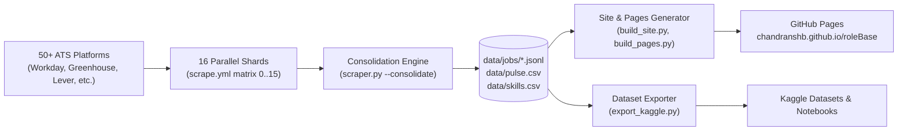

<p align="center">
  
</p>

<h1 align="center">RoleBase</h1>

<p align="center">
  <strong>Automated, distributed open job index and labor-market dataset across 50+ enterprise ATS platforms.</strong>
</p>

<p align="center">
  <a href="https://github.com/chandranshB/roleBase/actions/workflows/ci.yml"></a>
  <a href="https://github.com/chandranshB/roleBase/actions/workflows/scrape.yml"></a>
  <a href="https://github.com/chandranshB/roleBase/actions/workflows/kaggle.yml"></a>
  <a href="https://www.kaggle.com/datasets/chandranshbinjola/job-listings"></a>
  <a href="https://chandranshb.github.io/roleBase/"></a>
  <a href="LICENSE"></a>
</p>

---

## Overview

RoleBase continuously aggregates, enriches, and archives open job vacancies directly from over **110,000 employer career portals** across **51 applicant tracking systems** (Workday, Greenhouse, Lever, Ashby, SmartRecruiters, ADP, UKG Pro, Dayforce, Paylocity, Oracle HCM, Eightfold, and more).

Every posting is parsed and normalized with seniority level, professional field, required years of experience, yearly salary ranges, and technical/domain skills. Historical job closures are tracked to detect stale listings and ghost jobs.

* 🌐 **Live Web Search**: [chandranshb.github.io/roleBase](https://chandranshb.github.io/roleBase/)
* 📊 **Kaggle Relational Dataset**: [kaggle.com/datasets/chandranshbinjola/job-listings](https://www.kaggle.com/datasets/chandranshbinjola/job-listings)
* 📓 **Starter Analysis Notebook**: [Job Listings Explorer](https://www.kaggle.com/code/chandranshbinjola/job-listings-explorer)
* 🤖 **AI Agent & Developer Guide**: [AGENTS.md](AGENTS.md) · [ARCHITECTURE.md](docs/ARCHITECTURE.md)

---

## Key Features

* **10M+ Active Listings**: Deep index refreshed every 6 hours across 16 parallel runner shards; not restricted to tech (covers healthcare, manufacturing, finance, retail, logistics, education, and legal).
* **Early-Career ("Fresher-Friendly") Filter**: Isolates roles genuinely accessible to candidates with 0–2 years of experience; automatically flags and filters out "junior" titles quietly asking for 3+ years.
* **Ghost Job Risk Scoring**: Transparent heuristic audit flagging perpetual talent pools, undisclosed staffing agencies, serial reposts, and listings open >6–12 months.
* **Longitudinal Labor Market Metrics**: Daily snapshots tracking global open job volume, early-career hiring share, and daily demand shares across 80+ technical and non-technical skills.
* **100% Serverless & Open**: Fully automated on GitHub Actions; persists state in Git, publishes static indices to GitHub Pages, and updates Kaggle daily.

---

## Market Snapshot

<table>
  <tr>
    <td></td>
    <td></td>
  </tr>
  <tr>
    <td></td>
    <td></td>
  </tr>
  <tr>
    <td></td>
    <td></td>
  </tr>
  <tr>
    <td colspan="2"></td>
  </tr>
</table>

---

## Data Schemas

### 1. Kaggle Relational CSVs (`kaggle/`)

| File | Description | Key Fields |
| :--- | :--- | :--- |
| **`jobs.csv`** | Primary job database (open & closed <90 days) | `url`, `company`, `title`, `level`, `category`, `years_experience`, `skills`, `pay_min`, `pay_max`, `pay_currency`, `remote`, `ghost_score`, `first_seen`, `closed_at` |
| **`jobs_by_company.csv`** | Early-career hiring index by employer (5+ roles) | `company`, `open_roles`, `fresher_roles`, `fresher_share`, `junior_asking_3plus`, `years_stated_share` |
| **`open_jobs_daily.csv`** | Daily active and fresher job counts | `date`, `open_jobs`, `fresher_friendly_jobs` |
| **`skill_demand_daily.csv`** | Skill frequency time series | `date`, `skill`, `jobs`, `tagged`, `share_pct` |

### 2. Internal JSONL Store (`data/jobs/*.jsonl`)

One compact, sorted JSONL file per employer board. Empty and derivable values are omitted to minimize storage and diff size:

```json
{
  "id": "greenhouse:stripe:12345",
  "company": "Stripe",
  "title": "Software Engineer, Infrastructure",
  "location": "Seattle, WA",
  "country": "United States",
  "remote": true,
  "level": "senior",
  "category": "engineering",
  "employment": "full_time",
  "years": 5,
  "skills": ["python", "aws", "kubernetes"],
  "pay": [180000, 240000, "USD"],
  "posted": "2026-11-01",
  "first_seen": "2026-11-01",
  "closed_at": null,
  "reposts": 0
}
```

---

## Architecture



* **Crawl Pipeline**: 16 parallel runner shards partition the 110,000 employer boards with per-provider rate limiting and lane concurrency (`LANES`).
* **Consolidation**: Downloads shard artifacts, prunes jobs closed >90 days into `data/archive.csv`, and precomputes hiring analytics into `data/charts_cache.json`.
* **Zero-RAM Bottleneck**: Processing loops stream files using chunked iterators to operate strictly within standard GitHub Actions runner memory limits (<7 GB).

---

## Local Development

### Prerequisites
* Python 3.10+
* Git

### Setup
```bash
git clone https://github.com/chandranshB/roleBase.git
cd roleBase
pip install -r requirements-dev.txt
```

### Running Tests & Linting
```bash
# Run unit test suite
python -m unittest discover tests -v

# Run legacy integration checks
python test_scraper.py

# Run linter
ruff check rolebase tests
```

### Crawl & Site Build Commands
```bash
# Run single-shard crawl test
python scraper.py --shard 0 --total-shards 16

# Consolidate artifacts & precalculate analytics
python scraper.py --consolidate

# Generate static search indices (_site/)
python build_site.py

# Fetch company icons (cached in logo-cache/)
python build_logos.py

# Generate static SEO HTML pages
python build_pages.py

# Export Kaggle relational CSVs (kaggle/)
python export_kaggle.py
```

---

## Adding an Employer Board

1. Find the employer's ATS identifier:
   * **Greenhouse / Lever / Ashby / SmartRecruiters**: board slug from career page URL (e.g. `boards.greenhouse.io/<slug>`).
   * **Workday**: `<tenant>.<pod>.myworkdayjobs.com/<site>` (e.g. `adobe.wd5.myworkdayjobs.com/external_experienced`).
2. Add `"slug": "Company Name"` under the respective ATS key in [`companies.json`](companies.json).
3. *(Optional)* Add the company's domain to [`domains.json`](domains.json) for high-resolution logo resolution.

---

## Principles & Ethics

* **Official First-Party Sources Only**: Postings are fetched exclusively from public company ATS feeds and open APIs. Aggregators that restrict scraping (LinkedIn, Indeed, Naukri) are omitted on purpose.
* **No Wall Gardens**: Every search result links directly back to the employer's official job portal.
* **Polite Crawling**: Per-provider concurrency limits (`LANES`), exponential backoff on HTTP 429/5xx, and descriptive User-Agent headers.

---

## License

This project is licensed under the [GNU Affero General Public License v3.0](LICENSE).
Company names, logos, and trademarks belong to their respective employers and are used strictly for identification purposes.
