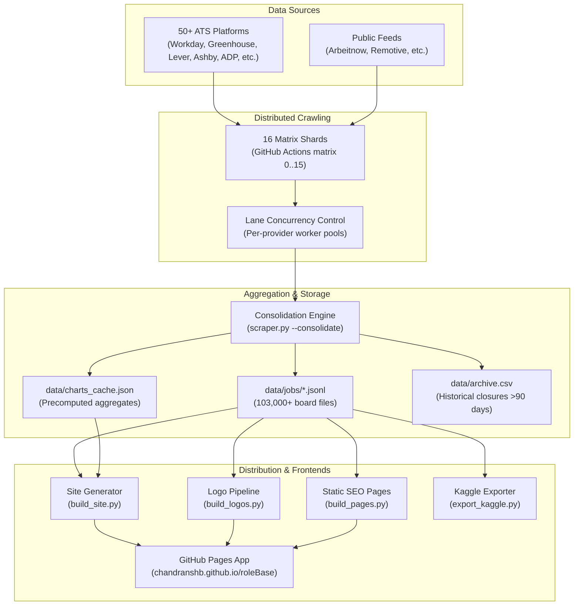

# RoleBase System Architecture & Pipeline Design

RoleBase is engineered for high throughput, low latency, and zero-maintenance continuous operation on standard free-tier GitHub Actions runners.

---

## 1. High-Level Architecture

---

## 2. Key Modules & Responsibilities

| Module | Responsibility |
| :--- | :--- |
| **`rolebase.config`** | Central configuration, regular expressions, country/state lookup dictionaries, and concurrency settings. |
| **`rolebase.client`** | Resilient `requests.Session` subclass with exponential backoff on connection drops and HTTP 429/5xx codes. |
| **`rolebase.normalize`** | High-performance extraction of seniority levels, categories, countries, skills, compensation, and fresher eligibility. |
| **`rolebase.ghost`** | Staleness and ghost job heuristic risk scoring. |
| **`rolebase.storage`** | Fast differential merging, compact JSONL serialization, and CSV persistence. |
| **`rolebase.consolidate`** | Shard artifact merging, pruning aged jobs (>90 days), and precomputing company statistics for instantaneous site builds. |
| **`rolebase.crawlers`** | Registry of crawlers supporting Workday, Greenhouse, Lever, Ashby, SmartRecruiters, ADP, Eightfold, and 45+ others. |
| **`scraper.py`** | Root entry point maintaining 100% backward compatibility for CLI commands and external imports. |

---

## 3. Resilience and Performance Optimizations

1. **Streaming Candidate Selection**:
   - `build_site.py` and `export_kaggle.py` stream `.jsonl` board files using multi-threaded generators (`ThreadPoolExecutor(max_workers=8)`), ensuring that at any instant only a few hundred boards reside in RAM.
2. **Precomputed Facets & Company Statistics**:
   - Instead of calculating hiring analytics across 10 million rows during site generation, `scraper.py --consolidate` calculates and caches metrics in `data/charts_cache.json` in under 3 minutes.
3. **Differential File Transfers**:
   - Crawl shards upload only boards that experienced modifications, reducing artifact payload sizes from ~500 MB down to < 50 MB per shard.
4. **Lane-Based Concurrency**:
   - Every ATS platform operates in an isolated worker lane with tuned concurrency limits (`LANES`), preventing a slow or rate-limited provider from blocking others.
